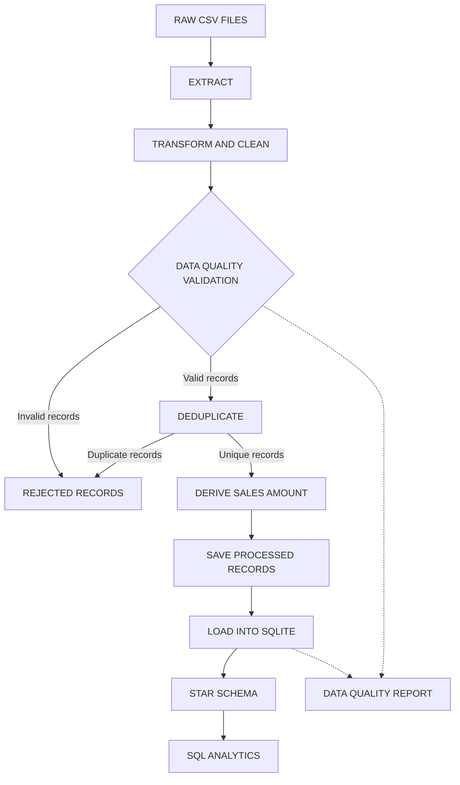
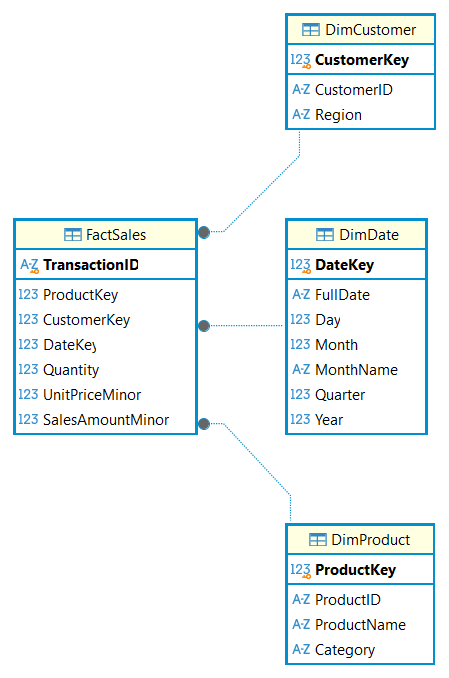

# Retail Sales ETL Pipeline

A beginner-friendly but professionally structured **batch data engineering project**.

This project reads messy retail sales CSV files, cleans and validates them using **Python and Pandas**, preserves invalid records with clear rejection reasons, and incrementally loads valid transactions into a **SQLite star-schema data warehouse** ready for SQL analytics.

> Built as a portfolio project for the Microsoft Data Engineer track (DEPI).
>
> **Tech Stack:** Python 3.13 | Pandas | SQLite | SQL | Pytest | Logging | Git

---

## Table of Contents

1. [Business Problem](#1-business-problem)
2. [Project Objectives](#2-project-objectives)
3. [Architecture](#3-architecture)
4. [ETL Workflow](#4-etl-workflow)
5. [Technology Stack](#5-technology-stack)
6. [Project Structure](#6-project-structure)
7. [Star Schema](#7-star-schema)
8. [Data Quality Rules](#8-data-quality-rules)
9. [Incremental Loading](#9-incremental-loading)
10. [Installation (Windows)](#10-installation-windows)
11. [Running in VS Code](#11-running-in-vs-code)
12. [Running the Tests](#12-running-the-tests)
13. [SQL Analytics](#13-sql-analytics)
14. [Actual Execution Results](#14-actual-execution-results)
15. [Screenshots](#15-screenshots)
16. [Limitations](#16-limitations)
17. [Future Improvements](#17-future-improvements)

---

## 1. Business Problem

A retail company receives sales transactions as CSV files from different sources, including an online store and physical retail stores.

These files may contain:

- Missing values, such as customer IDs, dates, quantities, and other fields.
- Duplicate transactions, where the same sale is exported more than once.
- Inconsistent formats, such as different date representations, currency symbols, and text capitalization.
- Invalid records, including negative quantities, zero prices, impossible dates, and malformed transaction IDs.

Analysts cannot reliably query this data in its raw form.

The company needs an automated pipeline that cleans, validates, transforms, and loads the data into a structured relational database **without silently losing rejected records**.

## 2. Project Objectives

- Build an end-to-end ETL pipeline: **Extract → Transform → Validate → Load → Report**.
- Apply clear and documented data-cleaning and validation rules.
- Preserve rejected records along with their rejection reasons.
- Generate an automated JSON data quality report for each successful pipeline run.
- Build a **star schema** consisting of one fact table and three dimension tables.
- Enforce primary keys, foreign keys, and database constraints.
- Support **incremental loading**, ensuring repeated runs do not insert duplicate transactions.
- Provide SQL analytics queries and an automated Pytest suite.

## 3. Architecture

The pipeline follows a batch-processing architecture:



The raw CSV files remain unchanged. Cleaned records, rejected records, database tables, and execution reports are generated separately.
## 4. ETL Workflow

`main.py` calls `src/pipeline.py::run_pipeline`, which orchestrates the following steps:

| Step | Module | What Happens |
|---|---|---|
| Extract | `extract.py` | Reads CSV files from `data/raw/` as text to prevent premature type conversion. Checks required columns and adds `source_file` and `source_row` fields for data lineage. |
| Transform | `transform.py` | Trims and standardizes text, normalizes dates, converts numeric values, and fills missing descriptive attributes using documented rules. |
| Validate | `validate.py` | Applies business rules for transaction ID format, dates, quantity and price ranges, and required fields. Invalid records receive rejection reason codes. |
| Deduplicate | `transform.py` | Separates repeated `TransactionID` values among valid records. The first occurrence is kept, while subsequent duplicates are preserved as rejected records. |
| Derive | `transform.py` | Calculates `sales_amount_minor = quantity * unit_price_minor` using integer arithmetic. |
| Save | `pipeline.py` | Saves unique valid records to `data/processed/` and rejected records, including their original values and rejection reasons, to `data/rejected/`. |
| Load | `load.py` | Initializes the database schema, inserts new dimension members, and loads only new transactions inside a database transaction. |
| Report | `report.py` | Generates a JSON data quality report containing execution statistics and database results. |

Sample data is generated by `src/generate_data.py` using a fixed random seed to ensure reproducibility.

## 5. Technology Stack

- **Python 3.13.5** – Main programming language.
- **Pandas 3.1.0** – Data cleaning, transformation, and processing.
- **SQLite** – Relational data warehouse using Python's built-in `sqlite3` module.
- **SQL** – Database schema design and analytical queries.
- **Pytest** – Automated testing.
- **Python Logging** – Execution logs and error tracking.
- **Git** – Version control.

**Project Scope:** This is a local batch data engineering project. It does not currently use paid APIs, cloud services, Docker, Airflow, or a web application.

## 6. Project Structure

```text
retail-sales-etl/
|
|-- data/
|   |-- raw/
|   |   |-- sales_online_store.csv
|   |   |-- sales_retail_stores.csv
|   |   `-- sales_batch_2.csv       # Generated incremental sample
|   |-- processed/                  # Cleaned valid records
|   `-- rejected/                   # Rejected records and reasons
|
|-- database/
|   `-- schema.sql                  # Star schema and constraints
|
|-- src/
|   |-- __init__.py
|   |-- config.py
|   |-- extract.py
|   |-- transform.py
|   |-- validate.py
|   |-- load.py
|   |-- report.py
|   |-- pipeline.py
|   |-- analytics.py
|   `-- generate_data.py
|
|-- sql/
|   `-- analytics_queries.sql       # 9 analytical queries
|
|-- tests/
|   |-- conftest.py
|   |-- test_extract.py
|   |-- test_transform.py
|   |-- test_validate.py
|   |-- test_load.py
|   `-- test_pipeline.py
|
|-- reports/                        # Generated JSON reports
|-- logs/                           # Generated pipeline logs
|-- screenshots/                    # Project screenshots
|
|-- main.py                         # Command-line entry point
|-- pytest.ini
|-- requirements.txt
|-- .gitignore
`-- README.md
```

## 7. Star Schema

The warehouse uses a dimensional model consisting of one fact table and three dimension tables.


### Database Diagram

The following diagram was generated directly from the SQLite database using DBeaver.



### FactSales

Stores individual sales transactions and their measurable values.

- `TransactionID` is the primary key and prevents duplicate transactions in the warehouse.
- `ProductKey`, `CustomerKey`, and `DateKey` are foreign keys referencing the dimension tables.
- `Quantity`, `UnitPriceMinor`, and `SalesAmountMinor` store the sales measures.

Each `TransactionID` represents one sales line in this dataset, rather than an order header containing multiple lines.

### Dimension Tables

- **DimProduct:** Stores product identifiers, names, and categories.
- **DimCustomer:** Stores customer identifiers and regions.
- **DimDate:** Stores calendar attributes, including day, month, quarter, and year.

### Money Handling

Monetary values are stored as integer minor units (cents) instead of floating-point values.

Examples:

- `$19.99` is stored as `1999`.
- `$1,299.99` is stored as `129999`.

The sales amount is calculated using:

```python
sales_amount_minor = quantity * unit_price_minor
```

The database enforces this calculation through a `CHECK` constraint:

```sql
CHECK (SalesAmountMinor = Quantity * UnitPriceMinor)
```

This avoids floating-point rounding issues in stored financial values.

### Database Constraints and Indexes

The schema enforces data integrity using:

- Primary keys for all dimension and fact tables.
- Unique constraints on product IDs, customer IDs, and full dates.
- Foreign key constraints between the fact and dimension tables.
- Check constraints for valid date components, positive quantities, positive prices, and consistent sales amounts.
- Indexes on `FactSales(ProductKey)`, `FactSales(CustomerKey)`, and `FactSales(DateKey)` to support analytical queries.

Foreign key enforcement is enabled per SQLite connection using:

```sql
PRAGMA foreign_keys = ON;
```

### Dimension Loading Strategy

The dimension-loading strategy is insert-only:

- Existing dimension members are not overwritten.
- New dimension members are inserted when encountered.
- Missing descriptive attributes are handled during transformation using known values from matching IDs or configured default values.
- Records with missing `CustomerID` or `ProductID` are rejected during validation.

This keeps previously loaded dimension records stable during incremental runs.

## 8. Data Quality Rules

The pipeline applies cleaning and validation rules before loading records into the warehouse.

### Standardization

- Removes leading and trailing whitespace.
- Collapses repeated spaces.
- Converts configured missing-value tokens into missing values.
- Standardizes identifier capitalization.
- Standardizes product names, categories, and regions.
- Normalizes supported date formats.
- Converts numeric fields into consistent representations.

### Missing Values

Missing values are handled according to field requirements:

- Missing transaction IDs, dates, quantities, prices, customer IDs, or product IDs result in rejection.
- Missing descriptive attributes can be inferred from other records with the same product or customer ID.
- If no matching known value exists, configured default values are applied to descriptive attributes.

### Validation

The pipeline checks:

- `TransactionID` presence and format.
- `CustomerID` and `ProductID` presence.
- Order date presence, parsing, and allowed date range.
- Quantity presence, integer values, and configured range.
- Unit price presence, valid decimal format, and configured range.
- Invalid numeric conversions.

The allowed quantity and unit price ranges are defined in `src/config.py`.

Dates earlier than the configured minimum date or later than the current validation date are rejected.

### Duplicate Handling

Duplicate detection is performed among valid records after validation.

- The first occurrence of a `TransactionID` is kept.
- Subsequent occurrences are marked with `DUPLICATE_TRANSACTION_ID`.
- Duplicate records are preserved in the rejected output.

Transactions already present in the warehouse are skipped during loading.

### Rejection Tracking

Rejected records are retained in `data/rejected/` with their rejection reasons.

A record may contain more than one rejection reason, separated by semicolons.

This makes data quality issues traceable and prevents invalid records from silently disappearing.

### Data Quality Reports

Each successful pipeline execution generates a JSON report containing information such as:

- Total input records.
- Valid records.
- Rejected records.
- Duplicate records.
- Missing values.
- Invalid numeric values.
- Rejection reasons.
- Imputed values.
- Loaded and skipped transactions.
- Warehouse table counts.
- Foreign key violation counts.
- Execution timestamp and source files.

## 9. Incremental Loading

The pipeline supports repeatable and incremental execution.

The loading process:

1. Extracts and processes the available CSV files.
2. Validates records and separates duplicates.
3. Inserts new dimension members.
4. Checks existing transaction identifiers.
5. Inserts only transactions not already present in the warehouse.
6. Commits the database transaction.

The expected behavior is:

- **First run:** Valid transactions are inserted.
- **Second run with unchanged input:** No new transactions are inserted.
- **New batch:** Only previously unseen valid transactions are inserted.
- **Repeated batch:** Previously loaded transactions are skipped.

The sample incremental batch generator creates a batch containing new transactions and repeated older transactions to demonstrate this behavior.

Run the incremental sample batch using:

```powershell
python main.py --add-sample-batch
```

## 10. Installation (Windows)

### Prerequisites

- Windows 10 or Windows 11.
- Python 3.13.
- Git (optional, for cloning the repository).

### Clone the Repository

```powershell
git clone https://github.com/moabdelkader05/retail-sales-etl.git

cd retail-sales-etl
```

### Create a Virtual Environment

```powershell
py -3.13 -m venv .venv
```

### Activate the Environment

```powershell
.\.venv\Scripts\Activate.ps1
```

If PowerShell blocks script execution, run:

```powershell
Set-ExecutionPolicy -Scope Process -ExecutionPolicy Bypass
```

Then activate the environment again.

### Install Dependencies

```powershell
python -m pip install -r requirements.txt
```

## 11. Running in VS Code

1. Open the project folder in VS Code.
2. Open the integrated terminal.
3. Activate the virtual environment.
4. Install the requirements if you have not already done so.
5. Run the pipeline.

### Run the Initial ETL Pipeline

```powershell
python main.py
```

### Run the Pipeline with SQL Analytics

```powershell
python main.py --analytics
```

### Generate and Process an Incremental Sample Batch

```powershell
python main.py --add-sample-batch
```

### View Available Command-Line Options

```powershell
python main.py --help
```

**Important:** The `--reset-db` option resets the warehouse database. Use it only when you intentionally want to start with an empty warehouse.

## 12. Running the Tests

Run the automated test suite from the project root:

```powershell
python -m pytest -v
```

### Verified Test Results

```text
93 passed in 13.09s
```

Verified on:

- Windows 11
- Python 3.13.5
- Pandas 3.1.0

The tests cover:

- CSV extraction and source handling.
- Data cleaning and transformation.
- Validation and rejection behavior.
- Database loading and incremental processing.
- End-to-end pipeline execution.

## 13. SQL Analytics

The project includes nine SQL analytical queries in:

`sql/analytics_queries.sql`

They support analysis of:

- Total revenue and transaction counts.
- Average transaction amount.
- Top-performing products.
- Revenue by product category.
- Revenue by region.
- Yearly sales performance.
- Quantity and sales trends.

The queries are designed to run against the SQLite warehouse.

To execute the analytics through the project:

```powershell
python main.py --analytics
```

## 14. Actual Execution Results

The following results were obtained from actual project executions.

### 14.1 Initial Load

| Metric | Result |
|---|---:|
| Online store records | 493 |
| Retail store records | 507 |
| Total input records | 1,000 |
| Valid records | 897 |
| Rejected records | 103 |
| Duplicate records | 25 |
| Inserted transactions | 897 |
| Foreign key violations | 0 |

### 14.2 Warehouse After Initial Load

| Table | Records |
|---|---:|
| DimProduct | 21 |
| DimCustomer | 150 |
| DimDate | 516 |
| FactSales | 897 |

### 14.3 Repeated Initial Run

Running the pipeline again with unchanged source data produced:

| Metric | Result |
|---|---:|
| New transactions inserted | 0 |
| Existing transactions skipped | 897 |
| FactSales records after run | 897 |

This confirms that the initial load is idempotent for unchanged input data.

### 14.4 Incremental Batch

The sample batch contains 122 records, including new transactions and repeated older transactions.

| Metric | Result |
|---|---:|
| Total records across source files | 1,122 |
| Valid records | 985 |
| Rejected records | 137 |
| Duplicate records | 47 |
| Newly inserted transactions | 88 |
| Existing transactions skipped | 897 |
| FactSales after incremental load | 985 |
| Foreign key violations | 0 |

### 14.5 Repeated Incremental Batch

Running the same incremental batch again produced:

| Metric | Result |
|---|---:|
| Newly inserted transactions | 0 |
| Existing transactions skipped | 985 |
| FactSales after run | 985 |
| Foreign key violations | 0 |

This demonstrates that previously loaded transactions are not inserted again.

### 14.6 Data Quality Details

The initial execution report recorded:

| Data quality metric | Count |
|---|---:|
| Missing values | 66 |
| Invalid numeric values | 27 |
| Invalid quantity values | 15 |
| Invalid unit price values | 12 |

These figures describe the initial input dataset and are not additional rejected-record counts.

### 14.7 Sample Analytics Results

The initial warehouse analytics produced:

| Metric | Result |
|---|---:|
| Total revenue | 152,892.76 |
| Total transactions | 897 |
| Average transaction amount | 170.45 |

**Top Products by Revenue**

| Product | Revenue |
|---|---:|
| Laptop Pro 15 | 36,009.71 |
| 27 Inch Monitor | 18,836.14 |
| Mechanical Keyboard | 13,606.21 |
| Noise Cancelling Headphones | 12,696.62 |
| Air Fryer | 9,061.85 |

**Revenue by Category**

| Category | Revenue |
|---|---:|
| Electronics | 85,421.87 |
| Home & Kitchen | 20,587.80 |
| Clothing | 19,007.59 |
| Sports & Outdoors | 10,749.69 |
| Beauty | 8,817.95 |
| Office Supplies | 8,307.86 |

**Revenue by Region**

| Region | Revenue |
|---|---:|
| Middle East | 39,047.69 |
| Asia Pacific | 35,320.20 |
| North America | 30,964.81 |
| Africa | 25,907.27 |
| Europe | 21,652.79 |

**Yearly Sales Performance**

| Year | Transactions | Units Sold | Revenue | Average Transaction |
|---|---:|---:|---:|---:|
| 2023 | 439 | 1,042 | 67,809.02 | 154.46 |
| 2024 | 458 | 1,091 | 85,083.74 | 185.77 |

**Note:** Average Transaction Amount is used instead of Average Order Value because each `TransactionID` represents one sales line in this dataset, rather than a complete customer order.

## 15. Screenshots

Project screenshots are stored in the `screenshots/` directory.

Suggested screenshots to include:

1. Project structure in VS Code.
2. Successful initial ETL execution.
3. Data quality JSON report.
4. SQLite star schema and table contents.
5. Incremental loading execution.
6. Successful Pytest results.
7. SQL analytics output.

Screenshots should show actual project executions and results rather than mockups.

## 16. Limitations

- The warehouse uses SQLite and is intended for a small demonstration dataset.
- The project processes CSV files in batch mode rather than streaming data.
- The dataset is synthetic and does not represent a real company's production transactions.
- The project has been verified in a local Windows environment; earlier execution and validation results were also obtained in Linux.
- The project does not currently include cloud deployment, orchestration, or a production monitoring platform.
- The insert-only dimension strategy does not implement full Slowly Changing Dimensions (SCD).

## 17. Future Improvements

Possible extensions include:

- Migrating the warehouse to Microsoft SQL Server or Azure SQL.
- Orchestrating the pipeline using Apache Airflow.
- Implementing cloud-based storage and processing with Azure Data Factory and Azure Data Lake.
- Adding Slowly Changing Dimensions (SCD Type 2).
- Adding data quality monitoring and alerting.
- Building automated CI workflows using GitHub Actions.
- Adding a dashboard using Power BI.

---

## Author

**Mohamed Abdelkader**

Telecommunications Engineer | Aspiring Data Engineer

- GitHub: https://github.com/moabdelkader05
- Project Repository: https://github.com/moabdelkader05/retail-sales-etl
