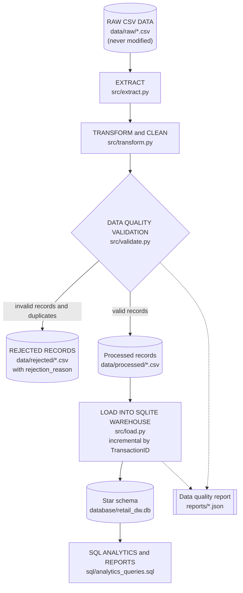
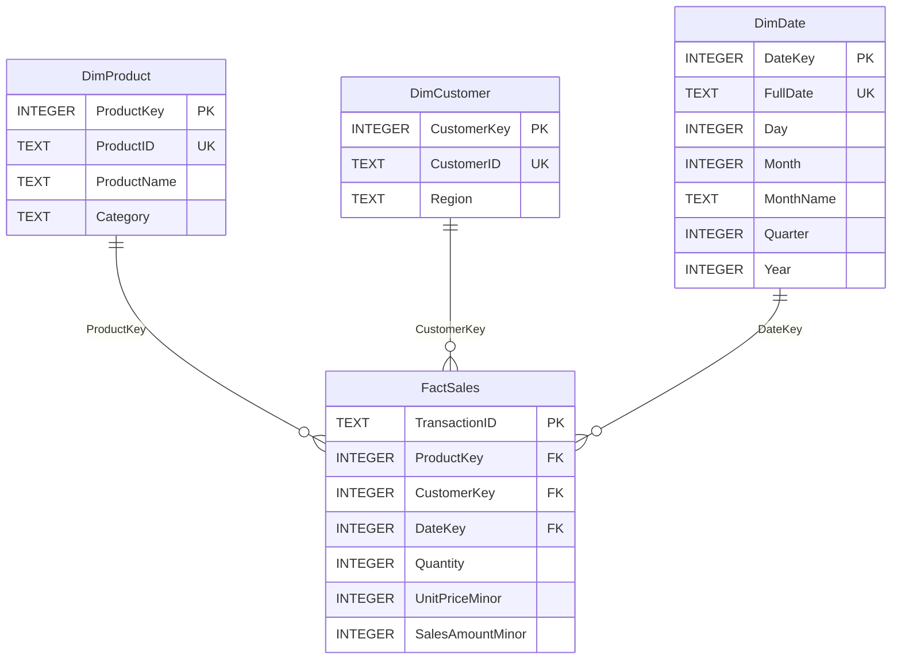

# Retail Sales ETL Pipeline

A beginner-friendly but professionally structured **batch data engineering project**.
It reads messy retail sales CSV files, cleans and validates them with **Python and Pandas**,
rejects bad records *with reasons*, and incrementally loads the good ones into a
**SQLite star-schema data warehouse** that is ready for SQL analytics.

> Built as a portfolio project for the Microsoft Data Engineer track (DEPI).
> Python 3 | Pandas | SQLite | SQL | Pytest | Logging | Git

---

## Table of contents

1. [Business problem](#1-business-problem)
2. [Project objectives](#2-project-objectives)
3. [Architecture](#3-architecture)
4. [ETL workflow](#4-etl-workflow)
5. [Technology stack](#5-technology-stack)
6. [Project structure](#6-project-structure)
7. [Star schema](#7-star-schema)
8. [Data quality rules](#8-data-quality-rules)
9. [Incremental loading](#9-incremental-loading)
10. [Installation (Windows)](#10-installation-windows)
11. [Running in VS Code](#11-running-in-vs-code)
12. [Running the tests](#12-running-the-tests)
13. [SQL analytics](#13-sql-analytics)
14. [Actual execution results](#14-actual-execution-results)
15. [Screenshots](#15-screenshots)
16. [Limitations](#16-limitations)
17. [Future improvements](#17-future-improvements)

---

## 1. Business problem

A retail company receives sales transactions as CSV files from different sources (an online
store and physical retail stores). The files contain:

- missing values (no customer, no date, no quantity, ...),
- duplicate transactions (the same sale exported twice, sometimes formatted differently),
- inconsistent formats (`2024-03-15`, `15/03/2024`, `Mar 15, 2024`; `$1,299.99`; `EUROPE` vs `europe `),
- invalid records (negative quantities, zero prices, impossible dates, malformed transaction IDs).

Analysts cannot trust or query this data directly. The company needs an automated pipeline that
cleans, validates, transforms and loads the data into a structured relational database, **without
silently losing any record**.

## 2. Project objectives

- Build an end-to-end ETL pipeline: **Extract -> Transform -> Validate -> Load -> Report**.
- Apply clear, documented cleaning and validation rules.
- Preserve every rejected record together with the reason it was rejected.
- Produce an automated **data quality report** (JSON) for every run, based on real results.
- Load a **star schema** (1 fact table + 3 dimensions) with primary keys, foreign keys and transactions.
- Support **incremental loading**: running the pipeline repeatedly never creates duplicates.
- Provide **SQL analytics** queries and an automated **Pytest** suite.

## 3. Architecture



## 4. ETL workflow

`main.py` calls `src/pipeline.py::run_pipeline`, which runs these steps:

| Step | Module | What happens |
|------|--------|--------------|
| **Extract** | `extract.py` | Reads every `*.csv` in `data/raw/` as text (so nothing is converted too early), checks the required columns, and adds `source_file` / `source_row` so every record can be traced back to its origin. Raw files are only read, never changed. |
| **Transform** | `transform.py` | Trims and standardizes text, normalizes dates to one format, converts numbers, and fills missing descriptive attributes using documented rules. |
| **Validate** | `validate.py` | Applies business rules (ID format, valid dates, valid quantity/price ranges, required fields). Each invalid record gets one or more rejection reason codes. |
| **Deduplicate** | `transform.py` | Among the valid records, repeated `TransactionID`s are separated (first occurrence kept) and preserved as rejected duplicates. |
| **Derive** | `transform.py` | `sales_amount_minor = quantity * unit_price_minor`, calculated with exact integer arithmetic (see [Money handling](#money-handling)). |
| **Save** | `pipeline.py` | Valid records go to `data/processed/`, rejected records (original values + reason) go to `data/rejected/`. |
| **Load** | `load.py` | Creates the schema from `database/schema.sql`, inserts dimension members and only the *new* transactions, all inside one database transaction. |
| **Report** | `report.py` | Writes `reports/data_quality_report_<timestamp>.json` from the actual run results. |

Sample data is generated by `src/generate_data.py` (fixed random seed, so it is reproducible).

## 5. Technology stack

- **Python 3** (tested with 3.13) with **Pandas** for transformation
- **SQLite** (`sqlite3` from the standard library) as the data warehouse
- **SQL** for the schema and analytics
- **Pytest** for automated tests
- **Python `logging`** (console + `logs/pipeline.log`)
- **Git** for version control

No paid APIs, no cloud services, no Docker, no Airflow, no web app.

## 6. Project structure

```
retail-sales-etl/
|-- data/
|   |-- raw/                       # source CSV files (read-only for the pipeline)
|   |   |-- sales_online_store.csv
|   |   `-- sales_retail_stores.csv
|   |-- processed/                 # valid, cleaned records per run (generated)
|   `-- rejected/                  # rejected records + rejection_reason per run (generated)
|-- database/
|   `-- schema.sql                 # star schema (tables, keys, constraints, indexes)
|-- src/
|   |-- __init__.py
|   |-- config.py                  # paths, validation limits, logging setup
|   |-- extract.py                 # read CSV files
|   |-- transform.py               # clean, standardize, deduplicate, derive
|   |-- validate.py                # business rules and rejection reasons
|   |-- load.py                    # SQLite connection, schema creation, incremental load
|   |-- report.py                  # data quality report helpers
|   |-- pipeline.py                # orchestrates the full workflow
|   |-- analytics.py               # runs the SQL analytics file
|   `-- generate_data.py           # synthetic data generator (with intentional problems)
|-- sql/
|   `-- analytics_queries.sql      # 9 analytical queries
|-- tests/
|   |-- conftest.py                # shared fixtures (small dataset with known problems)
|   |-- test_extract.py
|   |-- test_transform.py
|   |-- test_validate.py
|   |-- test_load.py
|   `-- test_pipeline.py
|-- reports/                       # data quality reports (JSON); two real examples are included
|-- logs/                          # pipeline.log (generated)
|-- screenshots/                   # see screenshots/README.md
|-- main.py                        # command line entry point
|-- pytest.ini
|-- requirements.txt
|-- .gitignore
`-- README.md
```

## 7. Star schema



- **FactSales** holds one row per transaction (the *grain*). `TransactionID` (the business key) is the
  primary key, which also makes duplicates impossible at database level.
- **Dimensions** use surrogate integer keys (`ProductKey`, `CustomerKey`) and keep the business ID as a
  `UNIQUE` column. `DimDate.DateKey` is a readable `YYYYMMDD` integer such as `20240315`.
- **Integrity**: `PRAGMA foreign_keys = ON` is enabled on every connection, plus `CHECK` constraints
  (`Quantity > 0`, `UnitPriceMinor > 0`, `SalesAmountMinor > 0`, `SalesAmountMinor = Quantity * UnitPriceMinor`,
  valid month/quarter ranges).
- Tables are created automatically from `database/schema.sql` (`CREATE TABLE IF NOT EXISTS`).

### Money handling

Money is stored and calculated as **integer minor units (cents)**, never as floating point numbers:
`19.99` is stored as `1999`.

- The price text is converted to cents once, during the transform step (`parse_price_minor`). Only plain decimals with
  **at most 2 decimal places** are accepted; a price such as `19.999` is rejected as `INVALID_UNIT_PRICE` instead of being silently rounded.
- `sales_amount_minor = quantity * unit_price_minor` is an exact integer multiplication.
- `FactSales.UnitPriceMinor` and `FactSales.SalesAmountMinor` are `INTEGER` columns, and the database itself checks
  that `SalesAmountMinor = Quantity * UnitPriceMinor`.
- SQL analytics sum the integers and divide by `100.0` only at the end, to display the result.
- The processed CSV files contain both the integer columns (the source of truth) and `unit_price` / `sales_amount`
  as 2-decimal text rendered from them, for readability.
- The project handles a single currency with 2 decimal places. Currency symbols (`$`, `€`, `£`) are removed from the text and there is no currency column or conversion.

### Dimension behaviour (insert-only, first loaded value wins)

Dimension rows are **insert-only**. The loader adds a product, customer or date only when its business key
(`ProductID`, `CustomerID`, `DateKey`) does not exist yet (`INSERT ... ON CONFLICT DO NOTHING`). It never updates an existing dimension row.
This is **not** a Slowly Changing Dimension of Type 1 (which would overwrite with the newest value) or Type 2 (which would keep history).

- The first product name/category or customer region that is loaded for a business key is kept forever.
- Later transactions with different attribute values are still loaded and linked to the existing dimension row, but the dimension row does not change.
- If one batch contains conflicting attributes for the same new member, the first row (file order) wins.
- A value filled by a default rule (for example region `Unknown`, because nothing better was known on first load) is also kept, even if a later batch contains the real region.

These behaviours are covered by automated tests (`test_load.py` and `test_pipeline.py`).

## 8. Data quality rules

All limits live in `src/config.py`.

### 8.1 Standardization (applied to every record)

| # | Rule |
|---|------|
| 1 | Leading/trailing whitespace is removed and repeated spaces are collapsed to one. |
| 2 | The placeholders `""`, `NA`, `N/A`, `NULL`, `NONE`, `NAN`, `-`, `?` (any letter case) are treated as **missing**. |
| 3 | `transaction_id`, `customer_id`, `product_id` are converted to **UPPER CASE** (`txn-000002 ` becomes `TXN-000002`). |
| 4 | `product_name`, `category`, `region` are converted to **Title Case** (`NORTH AMERICA` becomes `North America`). |
| 5 | Dates are parsed from these formats and stored as ISO `YYYY-MM-DD`: `2024-03-15`, `15/03/2024`, `15-03-2024`, `Mar 15, 2024`, `2024/03/15`. Ambiguous values such as `03/04/2024` are read as **day/month/year**. |
| 6 | `unit_price` may contain `$`, `€`, `£`, spaces and thousands commas; these are removed (`$1,299.99` becomes `1299.99`). |
| 7 | `quantity` is converted to a number. `unit_price` is converted to **integer cents** (`1299.99` becomes `129999`) and must be a plain decimal with at most 2 decimal places. Text that does not qualify (`abc`, `free`, `19.999`, `-5`, `1e3`) is rejected in validation; the original text is kept in the rejected file. |

### 8.2 Missing values

| Column | Rule |
|--------|------|
| `transaction_id`, `order_date`, `customer_id`, `product_id`, `quantity`, `unit_price` | **Never guessed.** The record is rejected (`MISSING_*`). |
| `product_name`, `category` | Filled with the most common known value for the same `product_id` in the batch; otherwise `Unknown Product` / `Uncategorized`. |
| `region` | Filled with the most common known value for the same `customer_id` in the batch; otherwise `Unknown`. |

### 8.3 Validation (rejection reason codes)

A record can have several reasons (separated by `;` in the rejected file).

| Reason code | Rule |
|-------------|------|
| `MISSING_TRANSACTION_ID` | Transaction ID is empty. |
| `INVALID_TRANSACTION_ID` | Does not match `TXN-` followed by 6 digits (for example `12345`, `TXN-ABC`). |
| `MISSING_ORDER_DATE` | Date is empty. |
| `INVALID_ORDER_DATE` | Date cannot be parsed (`31/02/2024`, `yesterday`). |
| `ORDER_DATE_OUT_OF_RANGE` | Date is before 2020-01-01 or in the future. |
| `MISSING_CUSTOMER_ID` / `MISSING_PRODUCT_ID` | Required identifier is empty. |
| `MISSING_QUANTITY` / `MISSING_UNIT_PRICE` | Value is empty. |
| `INVALID_QUANTITY` | Not a whole number between 1 and 100 (`-1`, `0`, `2.5`, `abc`, `9999`). |
| `INVALID_UNIT_PRICE` | Not a plain decimal with at most 2 decimal places between 0.01 and 10,000.00 (`-19.99`, `0`, `free`, `19.999`, `999999`). |
| `DUPLICATE_TRANSACTION_ID` | A **valid** record whose `TransactionID` already appeared earlier in the processed files. The first occurrence (files in name order, rows in file order) is kept. |

Duplicates are detected **after** standardization, so `txn-000010 ` and `TXN-000010` count as the same transaction.
**No record is silently discarded:** `total input = valid + rejected` always holds, and every rejected
record is written to `data/rejected/` with its original values, source file, source row and reasons.

### 8.4 Derived column

`sales_amount_minor = quantity * unit_price_minor` (integer cents, no rounding needed). Example: 3 x `19.99` = `3 * 1999` = `5997` = 59.97.

## 9. Incremental loading

`TransactionID` is the unique business identifier. On every run the loader does the following inside **one
database transaction** (everything is saved, or - if an error occurs - nothing is):

1. Ask `FactSales` which of the incoming `TransactionID`s already exist.
2. Keep only the **new** ones.
3. Insert missing dimension members (`INSERT ... ON CONFLICT DO NOTHING`). Existing products, customers and dates are reused **unchanged** (first loaded value wins; see [Dimension behaviour](#dimension-behaviour-insert-only-first-loaded-value-wins)).
4. Look up the surrogate keys and insert the new facts (`ON CONFLICT(TransactionID) DO NOTHING` as a second safety net).
5. Report `records_loaded` (inserted) and `records_skipped_already_loaded` (already in the warehouse).

Because the pipeline re-reads all files in `data/raw/`, running it again is safe. Dropping a **new CSV file** into
`data/raw/` adds only its new transactions. A record that was rejected earlier and later corrected in the source
is loaded as soon as it becomes valid.

## 10. Installation (Windows)

Requirements: Windows 11, Python 3 ([python.org](https://www.python.org/downloads/), tick *Add Python to PATH*), and optionally Git.
The project was developed and tested with Python 3.13; a recent Python 3 version (3.10 or newer) is expected to work but was not tested.

Open **PowerShell** in the project folder:

```powershell
# 1. Create and activate a virtual environment
py -m venv .venv
.\.venv\Scripts\Activate.ps1

# 2. Install the dependencies
python -m pip install --upgrade pip
python -m pip install -r requirements.txt
```

If PowerShell refuses to run the activation script, allow it for this window only and retry:

```powershell
Set-ExecutionPolicy -Scope Process -ExecutionPolicy Bypass
```

Run the pipeline:

```powershell
python main.py
```

Other commands:

```powershell
python main.py --analytics          # run the pipeline and print all 9 SQL analytics results
python main.py --add-sample-batch   # add data/raw/sales_batch_2.csv (new + already-loaded records), then run
python main.py --reset-db           # delete the warehouse database first, then reload everything
```

If `data/raw/` contains no CSV files, `main.py` generates the sample dataset automatically.

> **Upgrading from the previous version:** the money columns changed from `REAL` (`UnitPrice`, `SalesAmount`) to `INTEGER`
> (`UnitPriceMinor`, `SalesAmountMinor`). If you already have a `database/retail_dw.db` created by the old version, `main.py` stops with a clear
> error message. Run `python main.py --reset-db` once to rebuild the database.

## 11. Running in VS Code

1. **File > Open Folder...** and choose the `retail-sales-etl` folder.
2. Open the Command Palette (`Ctrl+Shift+P`), run **Python: Select Interpreter** and choose the one inside `.venv`.
3. Open the integrated terminal (``Ctrl+` ``) - it should show `(.venv)` at the start of the prompt.
4. Run `python main.py`.
5. Inspect the results: `reports/` (quality report), `data/rejected/` (rejected records with reasons) and
   `database/retail_dw.db` (open it with a SQLite extension such as *SQLite Viewer*).

## 12. Running the tests

```powershell
python -m pytest -v
```

The suite has 93 tests covering extraction, missing values, duplicates, validation rules, integer money handling and sales amount calculation,
database loading, foreign key integrity, incremental loading, dimension behaviour, rollback on errors, the full pipeline, and every SQL analytics query.
All tests use temporary folders and databases, so they never touch your real data.

## 13. SQL analytics

All queries are in [`sql/analytics_queries.sql`](sql/analytics_queries.sql) and run against the real schema
(`python main.py --analytics` executes all of them). Examples:

```sql
-- Top 5 products by revenue
SELECT p.ProductID, p.ProductName, p.Category, ROUND(SUM(f.SalesAmountMinor) / 100.0, 2) AS Revenue
FROM FactSales f
JOIN DimProduct p ON p.ProductKey = f.ProductKey
GROUP BY p.ProductKey, p.ProductID, p.ProductName, p.Category
ORDER BY SUM(f.SalesAmountMinor) DESC
LIMIT 5;

-- Monthly revenue
SELECT d.Year, d.Month, d.MonthName, COUNT(*) AS Transactions, ROUND(SUM(f.SalesAmountMinor) / 100.0, 2) AS Revenue
FROM FactSales f
JOIN DimDate d ON d.DateKey = f.DateKey
GROUP BY d.Year, d.Month, d.MonthName
ORDER BY d.Year, d.Month;
```

The file contains: total revenue, total transactions, average transaction amount, monthly revenue, top 5 products by
revenue, sales by category, sales by region, best-selling products by quantity, and a yearly summary.

Every `TransactionID` is **one sales line** (one product and one quantity), not a complete multi-item order, so the project reports an
**average transaction amount** rather than an "average order value".

## 14. Actual execution results

All numbers below were produced by really running the current version of the project (integer minor units for money;
Python 3.13.18, pandas 3.0.5, Linux) on the included synthetic dataset. The generated data has **1,000 raw rows in 2 files** with
intentional problems. The two reports in [`reports/`](reports/) (`example_report_run1_initial_load.json` and
`example_report_run3_incremental_load.json`) are the unedited reports of runs 1 and 3 below, produced by this version.
Switching the money columns from `REAL` to integer cents did not change any count or business figure of this dataset.

### 14.1 Incremental loading: four consecutive runs

| Run | Command | Input records | Valid | Rejected (of which duplicates) | Loaded | Skipped (already loaded) | `FactSales` rows after |
|-----|---------|--------------:|------:|-------------------------------:|-------:|-------------------------:|-----------------------:|
| 1 | `python main.py --reset-db` | 1,000 | 897 | 103 (25) | **897** | 0 | 897 |
| 2 | `python main.py` | 1,000 | 897 | 103 (25) | **0** | 897 | 897 |
| 3 | `python main.py --add-sample-batch` | 1,122 | 985 | 137 (47) | **88** | 897 | 985 |
| 4 | `python main.py` | 1,122 | 985 | 137 (47) | **0** | 985 | 985 |

- Run 2 and run 4 insert nothing: repeated executions are safe.
- Run 3 reads a new file (`sales_batch_2.csv`: 100 new transactions plus 20 already-loaded ones re-sent, plus the
  intentional problems that the generator adds to every file). Only the **88 genuinely new valid transactions** were inserted (897 + 88 = 985).
- The duplicate count in runs 3 and 4 is higher because the 20 re-sent transactions also appear in the older files. The pipeline sees them as repeated `TransactionID`s across files.

### 14.2 Data quality report: run 1 (initial load)

| Metric | Value |
|--------|------:|
| Total input records | 1,000 |
| Valid records | 897 |
| Rejected records | 103 |
| Duplicate records | 25 |
| Missing values (all columns, before filling) | 66 |
| Records with invalid numeric values | 27 (15 quantity, 12 unit price) |
| Successfully loaded records | 897 |
| Foreign key violations | 0 |

Missing values by column: `transaction_id` 5, `order_date` 6, `customer_id` 8, `region` 15, `product_name` 10, `category` 10, `quantity` 6, `unit_price` 6, `product_id` 0.
Values filled by the documented rules: 10 product names, 10 categories and 15 regions (all inferred from other rows of the same product or customer; no default value was needed).

Rejection reasons (run 1):

| Reason | Records |
|--------|--------:|
| DUPLICATE_TRANSACTION_ID | 25 |
| INVALID_QUANTITY | 15 |
| INVALID_UNIT_PRICE | 12 |
| MISSING_CUSTOMER_ID | 8 |
| INVALID_ORDER_DATE | 8 |
| INVALID_TRANSACTION_ID | 6 |
| MISSING_ORDER_DATE | 6 |
| MISSING_UNIT_PRICE | 6 |
| ORDER_DATE_OUT_OF_RANGE | 6 |
| MISSING_QUANTITY | 6 |
| MISSING_TRANSACTION_ID | 5 |

(These sum to 103 because no record in this dataset has more than one reason.)

### 14.3 Warehouse record counts

| Table | After run 1 | After run 3 / 4 |
|-------|------------:|----------------:|
| `DimProduct` | 21 | 21 |
| `DimCustomer` | 150 | 150 |
| `DimDate` | 516 | 573 |
| `FactSales` | 897 | 985 |

Direct checks on the final database (run 4): `PRAGMA integrity_check` returned `ok`, `PRAGMA foreign_key_check`
returned no violations, `COUNT(DISTINCT TransactionID)` equals `COUNT(*)` (985 = 985), `UnitPriceMinor` and `SalesAmountMinor` are stored with
SQLite type `integer` in every row, `SalesAmountMinor = Quantity * UnitPriceMinor` holds for every row, `SUM(SalesAmountMinor)` is
17,114,895 cents (171,148.95), which equals the sum of the `sales_amount` text values in the processed file calculated independently with
Python `Decimal`, and the raw CSV files had identical SHA-256 hashes before and after all runs.

### 14.4 SQL analytics results (after run 1)

| Metric | Result |
|--------|-------:|
| Total revenue | 152,892.76 |
| Total transactions | 897 |
| Average transaction amount | 170.45 |

Top 5 products by revenue:

| ProductID | Product | Category | Revenue |
|-----------|---------|----------|--------:|
| PRD-105 | Laptop Pro 15 | Electronics | 36,009.71 |
| PRD-104 | 27 Inch Monitor | Electronics | 18,836.14 |
| PRD-102 | Mechanical Keyboard | Electronics | 13,606.21 |
| PRD-103 | Noise Cancelling Headphones | Electronics | 12,696.62 |
| PRD-203 | Air Fryer | Home & Kitchen | 9,061.85 |

Sales by category and by region:

| Category | Revenue | Share | | Region | Revenue |
|----------|--------:|------:|-|--------|--------:|
| Electronics | 85,421.87 | 55.87% | | Middle East | 39,047.69 |
| Home & Kitchen | 20,587.80 | 13.47% | | Asia Pacific | 35,320.20 |
| Clothing | 19,007.59 | 12.43% | | North America | 30,964.81 |
| Sports & Outdoors | 10,749.69 | 7.03% | | Africa | 25,907.27 |
| Beauty | 8,817.95 | 5.77% | | Europe | 21,652.79 |
| Office Supplies | 8,307.86 | 5.43% | | | |

Yearly summary:

| Year | Transactions | Units sold | Revenue | Average transaction amount |
|-----:|-------------:|-----------:|--------:|---------------------------:|
| 2023 | 439 | 1,042 | 67,809.02 | 154.46 |
| 2024 | 458 | 1,091 | 85,083.74 | 185.77 |

The monthly revenue, sales by category/region, best-selling products and the other queries are printed in full by `python main.py --analytics`.
The data is synthetic, so these business figures only demonstrate the pipeline.

### 14.5 Pytest results

`python -m pytest -v` -> **93 passed, 0 failed**.

| Test file | Tests | Focus |
|-----------|------:|-------|
| `test_extract.py` | 8 | reading CSVs, lineage columns, multiple/new files, missing columns, raw files unchanged, generator |
| `test_transform.py` | 31 | text standardization, date/number parsing, price-to-cents conversion (valid and invalid formats), missing-value rules, duplicate detection, integer sales amount, no floating point drift |
| `test_validate.py` | 27 | each rejection reason, multiple reasons, quantity/price limits, valid and invalid price formats, extreme dates |
| `test_load.py` | 14 | schema creation, INTEGER money columns, foreign keys, amount consistency check, dimension/fact loading, insert-only dimensions, incremental load, rollback on error, old-schema detection |
| `test_pipeline.py` | 13 | report accuracy, rejected/processed files, repeated runs, new file, full workflow, all 9 SQL queries, `Average Transaction Amount` naming, revenue consistency across queries, dimension behaviour |

The same suite also passes with pandas 2.2.3 (93 passed), so it works with both pandas 2.x and 3.x.

Testing found two real bugs, which were fixed: a date such as `2999-01-01` made Pandas overflow and crash the whole
pipeline instead of rejecting the record (now covered by a regression test), and a missing-value edge case failed
under pandas 2.x.

## 15. Screenshots

No screenshots are included. The project was built and run in a headless Linux environment without a desktop, so real
screenshots of VS Code/PowerShell could not be captured, and none were faked. The terminal output above is copied
from real runs. See [`screenshots/README.md`](screenshots/README.md) for the list of screenshots to capture on your own
machine and then add here, for example:

```markdown

```

## 16. Limitations

- Developed and tested on Linux (Python 3.13). It uses only cross-platform code, but it has **not been run on Windows 11** yet.
- One `TransactionID` is one sales line (there is no separate order header/line structure), so the project reports an average transaction amount, not an average order value.
- Dimensions are insert-only: the first loaded product name/category and customer region are kept and never updated (this is neither SCD Type 1 nor Type 2), so later changes are not tracked.
- Money is handled as integer cents for a single currency with 2 decimal places. There is no currency column or conversion (symbols such as `$` or `€` are simply removed), and prices with more than 2 decimals are rejected.
- Each run re-reads every file in `data/raw/`. Incremental logic is applied when loading, not by tracking file offsets or archiving processed files.
- When the same `TransactionID` appears twice with *different* values, the first one wins and the other is rejected as a duplicate; conflicts are not analysed.
- Dates such as `03/04/2024` are always read as day/month/year.
- A CSV with a broken structure (for example a row with the wrong number of fields) fails the whole file with a clear error instead of being partly read.
- The data is synthetic. Pandas holds each batch in memory, so very large files would need chunked processing.

## 17. Future improvements

- Archive processed raw files and keep a `LoadAudit` table with one row per run.
- Update or version dimension attributes (SCD Type 1 overwrite or Type 2 history) instead of insert-only dimensions.
- A `currency` column for multi-currency data.
- Order header/line tables and a `DimStore`/`DimChannel` dimension.
- A configurable rules file (YAML) instead of constants in `config.py`.
- Chunked reading for large files, and Parquet output for the processed layer.
- Scheduling the daily run (for example Windows Task Scheduler or cron).
- Continuous integration (GitHub Actions) that runs `python -m pytest -v` on every push.
